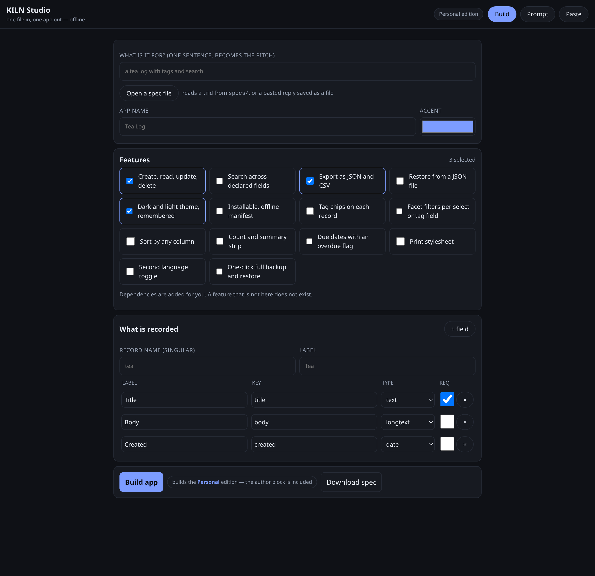

# Guide — quickstart

> **TL;DR** — clone, run one command, open one file. Five minutes, no install, no account,
> no network.

---

## 1. Get it

```bash
git clone https://github.com/drsamonline/KILN.git
cd KILN
python3 -m kiln doctor
```

`doctor` prints what the machine has. If it says `network needed  no`, you are ready.

| Requirement | Detail |
|---|---|
| Python | 3.9 or newer |
| Packages | none |
| Node | optional, only to syntax-check emitted JavaScript |
| Browser | any, to open the result |

## 2. Build something

```bash
python3 -m kiln pipeline "a water log with a daily goal" --zip
```

| Step | What it did |
|---|---|
| 1 | wrote a spec to `out/app-water-log.md` |
| 2 | emitted one file, `out/app-water-log/index.html` |
| 3 | verified it — 40+ checks, provenance, wiring, JS parse |
| 4 | packaged it as `out/app-water-log.zip` |

## 3. Open it

Double-click `out/app-water-log/index.html`. Add a row. Reload. It is still there.

## 4. Do it properly

```bash
python3 -m kiln new "a tea log with tags and search"     # a spec you can edit
python3 -m kiln compose specs/app-tea.md                 # the file plan, no writes
python3 -m kiln build specs/app-tea.md -o out            # emit, then verify
python3 -m kiln verify out/app-tea --json                # the evidence
```

## 5. Or on a phone

Send yourself `studio.html` (50 KB). Open it. Fill three boxes. Tap **Build app**. The app
downloads. No Python, no network.

---

## What you should see

<div align="center">

</div>

---

## Common mistakes

| Message | Fix |
|---|---|
| `unknown features: x` | `python3 -m kiln catalogue` lists what exists |
| `does not match filename` | rename the spec file to its `id` |
| `names no observable outcome` | rewrite the done-means as something a person can watch happen |
| `no ```json kiln block found` | `python3 -m kiln adopt` can add one |
| an app shows "Nothing here yet" | correct — there are no rows yet |

## Links

- [`INSTALL.md`](INSTALL.md) — every platform
- [`USAGE.md`](USAGE.md) — the day-to-day loop
- [`GUIDE-SPEC-REF.md`](GUIDE-SPEC-REF.md) — every key and type
- [`PROMPT.md`](PROMPT.md) — if you would rather a model wrote the spec
