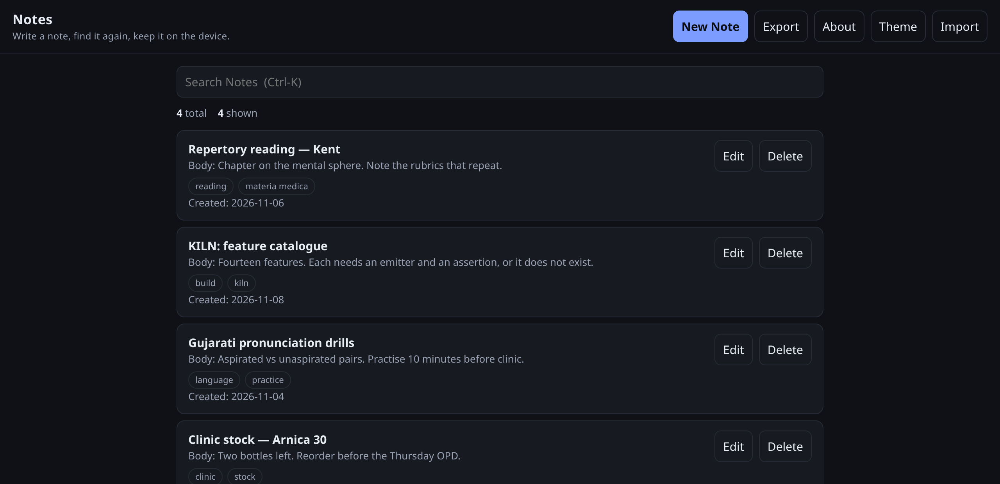
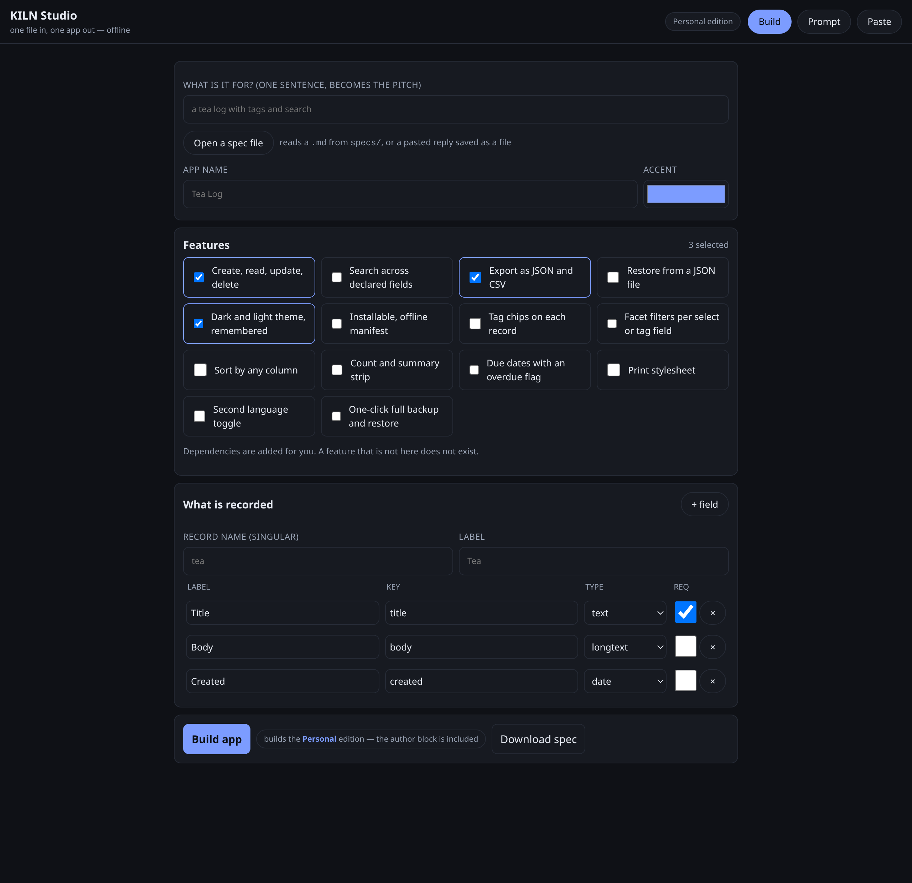

<div align="center">

# KILN

**Spec in. Finished app out.**

A deterministic compiler that turns a small specification into a complete, working,
offline application — one HTML file. No model in the loop, no network, nothing to install.

[](https://github.com/drsamonline/KILN/actions/workflows/kiln.yml)
[](#verification)
[](#verification)
[](#self-contained)
[](#self-contained)
[](#quick-start)
[](#what-a-generated-app-contains)
[](LICENSE)

[Landing page](https://drsamonline.github.io/KILN/) ·
[Live demo](demo.html) — a gallery of every spec ·
[Studio](studio.html) ·
[User guide](USAGE.md) ·
[All docs](docs/README.md) ·
[Prompt](PROMPT.md)



</div>

---

## The idea

Forge made the shape of an app and left the rest to an agent. KILN finishes the job
with a compiler instead: the boring 90% — storage, forms, search, export, error paths,
docs, tests — is written once, in the template, and every generated app inherits it.

| | |
|---|---|
| **Input** | one spec: a JSON block and a prose contract, in one Markdown file |
| **Output** | one `index.html` (~21 KB) that runs from a USB stick |
| **Model** | optional. A copy-paste prompt, never an API call |
| **Network** | never, for any command |
| **Dependencies** | none. Python 3.9+ and the standard library |

---

## Three ways in, one result

| Way | You have | You run | You get |
|---|---|---|---|
| **Phrase** | one sentence | `python3 -m kiln new "a tea log with tags"` | a spec |
| **Prompt** | any chat model, or none | `kiln prompt` → paste → `kiln adopt reply.md` | a spec |
| **Form** | a phone or a browser | open `studio.html`, tap Build — or open an existing spec file | an app, immediately |

<div align="center">

<br><sub>KILN Studio — 50 KB, one file, runs on a phone with no network.</sub>
</div>

---

## Quick start

```bash
git clone https://github.com/drsamonline/KILN.git && cd KILN

# whole pipeline in one command
python3 -m kiln pipeline "a reading log with tags and a rating" --zip

# or step by step
python3 -m kiln new "a notes app with tags, search and export"
python3 -m kiln build specs/app-notes.md -o out
python3 -m kiln verify out/app-notes
```

No `pip install`. No `npm install`. No `.env`. No API key. No network.

---

## The prompt bridge

`PROMPT.md` holds one prompt with five placeholders and the whole feature catalogue
inside it. Copy it into any chat window, fill it, paste the reply back:

```bash
python3 -m kiln prompt --idea "a tea log" --record "teas" --out p.txt
# ... paste p.txt into any model, save the reply as reply.md ...
python3 -m kiln adopt reply.md --build
```

`kiln adopt` is the part that matters: it finds the spec anywhere in the reply, repairs it,
and refuses to write something that cannot build.

| The model does this | KILN does this |
|---|---|
| Adds chatter around the spec | finds the block, ignores the words, says so |
| Uses ```json or no fence at all | finds the object anyway |
| Writes `"string"`, `"textarea"`, `"integer"`, `"datetime"` | maps to `text`, `longtext`, `number`, `date` |
| Invents a feature | drops it, names it |
| Forgets `search` that `filters` requires | adds it |
| Writes `"works as expected"` as done-means | replaces it with a real assertion |
| Returns entities or fields as objects | converts both to lists |
| Omits half the sections | generates them |
| Uses smart quotes, trailing commas, Python literals | repairs the JSON |
| Returns nothing usable | refuses, and says what to re-send |

A sloppy model cannot produce a broken app. Verified by
[`tests/fixtures/reply-sloppy.md`](tests/fixtures/reply-sloppy.md): 24 repairs, then 7 files,
then a passing verification.

---

## Commands

| Command | What it does | Network |
|---|---|---|
| `kiln pipeline "<idea>" --zip` | idea → spec → app → verify → zip | no |
| `kiln new "<phrase>"` | phrase → spec file | no |
| `kiln prompt` | print the prompt for any model | no |
| `kiln adopt <file> [--build]` | model reply → spec → app | no |
| `kiln compose <spec>` | show the file plan, write nothing | no |
| `kiln build <spec>` / `--all` | emit the app, then verify it | no |
| `kiln verify <dir>` / `--all` | read the artifact, print evidence | no |
| `kiln verify <dir> --golden` | compare with the build you last accepted | no |
| `kiln licence list` | keys issued from this machine, and their expiry | no |
| `kiln studio` | rebuild `studio.html` | no |
| `kiln guide` / `--check` | regenerate the two generated guides, or fail if stale | no |
| `kiln demo` | rebuild `demo.html` | no |
| `kiln catalog` | features, kits, assertions | no |
| `kiln audit` | 200 guards over this repository | no |
| `kiln doctor` | what this machine can do | no |

---

## What a generated app contains

| Part | Detail |
|---|---|
| `index.html` | the whole app, 34–42 KB: embedded model, runtime, styles. **The output is one file** |
| Storage | namespaced `localStorage`, versioned, quota-aware, corrupt-state recovery |
| CRUD | list, create, edit, delete — generated from the entity schema |
| Search | field scan, `Ctrl-K` to focus |
| Export / import | JSON and CSV download, JSON restore |
| Theme | dark and light, remembered |
| Failure path | bad input, no network, storage full, corrupt state — all four handled |
| `README.md`, `app.json`, `CHANGELOG.md`, `LICENSE` | optional, with `--with-docs` |
| `tests/smoke.py` | behaviour assertions for that specific app |
| `.github/workflows/build-apps.yml` | packaging, if you want it |

---

## Self-contained, on purpose

| Dependency | Status |
|---|---|
| Other drsamonline repos | none — the five "kits" are regions of the template, in this repo |
| Python packages | none, standard library only |
| Node | optional, only to syntax-check emitted JavaScript |
| Git | optional, only for `verify --at <sha>` and `preflight` |
| GitHub | optional: CI, releases, Pages |
| Internet | not required, ever |

Detail and the check: [`docs/SELF-CONTAINED.md`](docs/SELF-CONTAINED.md).

---

## Portability

| Where | How |
|---|---|
| Linux, macOS, Windows | `python3 -m kiln …` |
| Android, iOS, any phone | open `studio.html` in the browser, tap Build |
| Any browser, any OS | open a generated `index.html` |
| Windows EXE / Android APK | your `app-builder`, if you wire it |

Detail: [`docs/PORTABILITY.md`](docs/PORTABILITY.md).

---

## Verification

Nothing here is claimed without a command and its output.

| Check | What it proves |
|---|---|
| `python3 -m unittest discover -s tests` | 252 tests, Python 3.9 → 3.13 |
| `python3 -m kiln verify --all` | every spec builds; 700 checks across thirteen specs |
| `python3 -m kiln audit` | 85 guards: wiring, drift, licences, workflows, studio, prompt, site, links, support |
| `kiln verify --at <sha>` | the artifact is read at the commit, not the working tree |

---

## Two editions

| | **Personal** — free | **Commercial** — paid |
|---|---|---|
| Licence | PolyForm Noncommercial 1.0.0 | a written licence |
| For | personal, academic, hobby, non-profit | businesses, paid work, products you sell |
| Features | all 14 | all 14, unlocked |
| Sponsor block in the app | **yes** | no |
| Author block in the app | **yes** | no |
| Compiler credit | "Built with KILN", hyperlinked | one line, "Built with KILN" |
| Try it online | **yes** — [the live demo](demo.html) | — |

```bash
kiln build specs/app-x.md                      # Personal: no key, sponsor block in About
kiln licence activate KILN1.…                  # a purchased key
kiln build specs/app-x.md                      # Commercial: sponsor block gone
kiln licence tiers                             # what each edition carries
```

Every build carries a fingerprint of the model it came from, and the app recomputes it on
boot: a file edited after it was built says so. That is a deterrent and an evidence trail,
not DRM — [`SECURITY.md`](SECURITY.md) lists exactly what is and is not enforced, and
[`LICENSING.md`](LICENSING.md) has the full table. No releases are published until the owner
says so ([`RELEASE.md`](RELEASE.md)).

<!-- support:sweep -->
## Support

KILN is free for personal, academic, hobby and non-profit use. If it saved you a week,
the usual shapes are below — and the first one costs nothing.

| | |
|---|---|
| UPI (India) | `drsohilboi@ybl` — payee Dr Sohil Momin, open amount, or scan [the QR](docs/assets/upi-qr.svg) |
| GitHub Sponsors | [github.com/sponsors/drsamonline](https://github.com/sponsors/drsamonline) |
| Ko-fi | [ko-fi.com/matneo](https://ko-fi.com/matneo) |
| PayPal | [paypal.me/drsohilmomin](https://paypal.me/drsohilmomin?locale.x=en_GB&country.x=IN) |
| My books | [Amazon author store](https://www.amazon.com/stores/author/B08ZT331LY/allbooks?ccs_id=aed72b9f-71d9-41dc-adee-e9368a317acc) |
| More apps | [drsamonline.github.io](https://drsamonline.github.io/) |
| Email | [sohilmomin2000@gmail.com](mailto:sohilmomin2000@gmail.com) |

### Get help, not just give money

| You need | Where |
|---|---|
| Use it and report what broke | [open an issue](https://github.com/drsamonline/KILN/issues/new/choose) — worth more than a donation |
| Ask a question | [discussions](https://github.com/drsamonline/KILN/discussions) |
| Report a vulnerability | [SECURITY.md](SECURITY.md) — privately, please |
| A commercial licence | [COMMERCIAL.md](COMMERCIAL.md) |
| Contribute a feature | [CONTRIBUTING.md](CONTRIBUTING.md) — four steps, all checked by CI |

---

## Repository

| Path | Contents |
|---|---|
| `GUIDE-*.md` | six guides: quickstart, spec reference, features, cookbook, patterns, contribute |
| `PROMPT.md` | the prompt bridge, with the catalogue in it |
| `index.html` | the landing page |
| `demo.html` | a real generated app, inlined and running |
| `studio.html` | the browser version, built from the same sources |
| `PLAN.md` | phases and falsifiable acceptance criteria |
| `AUDIT-FORGE.md` | every Forge defect, and the guard against it |
| `SPEC-SHAPE.md` · `schema/` | what a spec must say, machine-checked |
| `catalogue/` | features, kits, categories, licence |
| `kiln/` | the compiler, including `guide.py`, which writes two of the guides |
| `templates/` | the runtime, the studio, the demo |
| `specs/` | one spec per app; `specs/gallery/` holds one per archetype |
| `tests/` | 252 tests: the Ed25519 RFC vector, determinism, the registry, the archetypes, and the tracker maths run under node |
| `docs/` | architecture, portability, workflow, self-containment, spec reference, FAQ, [patterns](docs/PATTERNS.md) — start at [`docs/README.md`](docs/README.md) |
| `INDEX.md` | generated list of every spec |
| `CITATION.cff` | how to cite it |

---

<div align="center">
<sub>

KILN compiles specifications into software. It does not call a model, does not collect data,
and does not warrant that a generated app suits your purpose — check it before you rely on it.

[Licence](LICENSE) · [Terms](TERMS.md) · [Privacy](PRIVACY.md) · [Security](SECURITY.md) ·
[Disclaimer](DISCLAIMER.md) · [Notice](NOTICE)<br>
PolyForm Noncommercial 1.0.0 · © 2026 Dr Sohil Momin

</sub>
</div>
